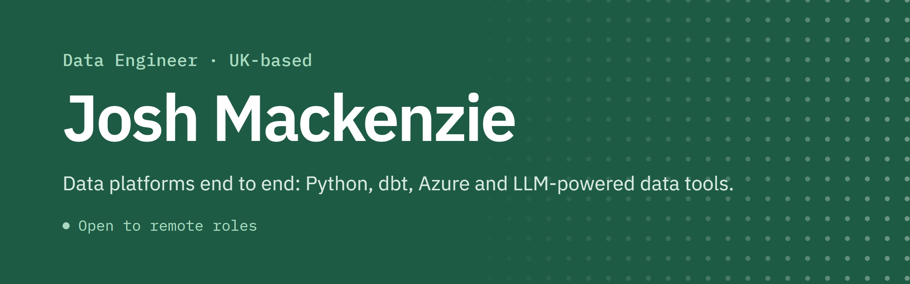
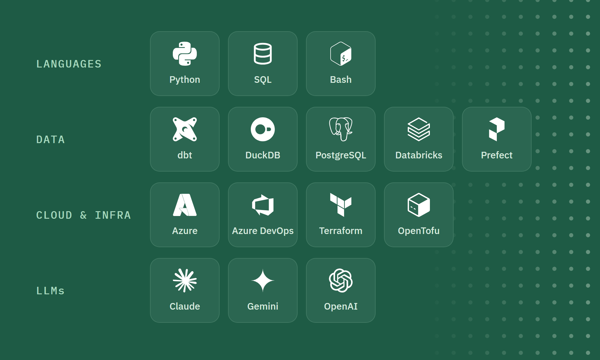

  &nbsp;
  &nbsp;
  

I'm a data engineer who builds data platforms end to end. I'm currently the sole data engineer at a carbon reporting platform, owning the data platform and helping shape the product.

Open to remote data engineering roles.

### Recent work

<table>
  <tr>
    <td><b>LLM&nbsp;bill&nbsp;extraction</b></td>
    <td>Multi-model extraction (Claude, Gemini, GPT) for energy bill PDFs, reaching 95%+ accuracy across 1,200 bills</td>
  </tr>
  <tr>
    <td><b>UN&nbsp;IOM</b></td>
    <td>The Python pipeline behind an LLM document-classification tool for the International Organization for Migration</td>
  </tr>
  <tr>
    <td><b>Data&nbsp;platform</b></td>
    <td>Built from scratch on dbt, DuckDB and Azure, with data quality and freshness monitoring</td>
  </tr>
  <tr>
    <td><b>Sports&nbsp;data</b></td>
    <td>Hundreds of SQL and dbt pipelines for major sports teams and leagues</td>
  </tr>
</table>

### Stack

